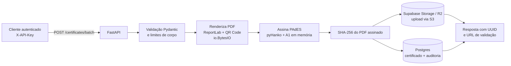
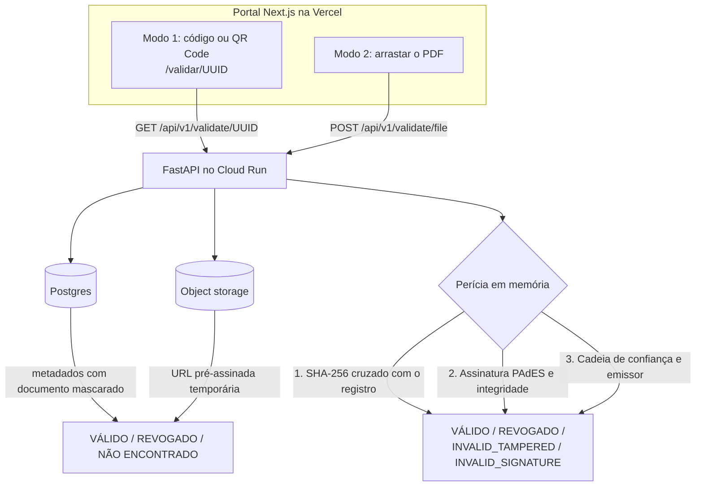

# Certificados API

Plataforma de emissão e validação de certificados com **assinatura digital PAdES (ICP-Brasil A1)**, sem estado e sem escrita em disco.

- **Emissão em lote**: gera o PDF com QR Code, assina com o certificado A1 e guarda no object storage.
- **Validação dupla e pública**: por código/QR Code e por perícia criptográfica do próprio PDF.
- **Portal Next.js** pronto para a Vercel e **API FastAPI** pronta para o Google Cloud Run.

| Camada | Tecnologia |
| --- | --- |
| API | Python 3.11, FastAPI, pyHanko (PAdES), ReportLab, qrcode, asyncpg |
| Dados | Supabase Postgres (log de auditoria *append-only*) |
| Arquivos | Object storage compatível com S3 via boto3: Supabase Storage ou Cloudflare R2 |
| Portal | Next.js 15 (App Router), TypeScript estrito, Tailwind CSS |
| Entrega | Docker multi-stage, GitHub Actions, Cloud Run, Vercel |

---

## Arquitetura *Cloud-Native Stateless* e *Zero-Disk Footprint*

A API não guarda nada entre requisições e não escreve em disco. Por isso roda em contêiner com **sistema de arquivos somente leitura**, escala a zero e se recupera de qualquer reinício.

- **Stateless**: o estado vive no Postgres e no bucket. Qualquer instância atende qualquer requisição.
- **Zero-disk**: PDFs, QR Codes, o `.pfx` e os uploads de validação passam só por `io.BytesIO`/`bytes`. O limite de upload fica abaixo de 1 MiB de propósito: acima disso o Starlette gravaria o multipart em arquivo temporário.
- **Segredos só por variável de ambiente**: o certificado A1 entra como Base64 em `SIGNING_PFX_BASE64`. Nenhum `.pfx`, `.pem` ou `.key` é versionado (o CI bloqueia).
- **Privacidade (LGPD)**: documentos são sempre mascarados nas respostas públicas; o motivo de uma revogação não é exposto.

### Pipeline de emissão PAdES em memória



### Validação dupla (pública)



**Como o veredito do upload é composto**

| Camada | Pergunta | Resultado negativo |
| --- | --- | --- |
| Hash | O SHA-256 do arquivo existe nos certificados emitidos? | `INVALID_TAMPERED` ou `INVALID_SIGNATURE` |
| Assinatura | Os bytes assinados estão intactos e a assinatura confere? | `INVALID_TAMPERED` |
| Confiança | O emissor pertence à cadeia desta plataforma e é o mesmo do registro? | `INVALID_SIGNATURE` |

> **Limitação conhecida**: a âncora de confiança é a cadeia do A1 atual. Depois que você trocar o certificado A1, PDFs antigos continuam íntegros, mas aparecem como "cadeia não confiável" até que âncoras adicionais sejam configuradas.

---

## Estrutura do repositório

```text
app/                  API FastAPI (core, api, crypto, repositories, services, schemas)
scripts/              generate_dev_cert.py e smoke_step1.py … smoke_step6.py
sql/                  001_schema.sql, 002_issuance.sql (execute no Supabase, nessa ordem)
tests/                suíte pytest (sem rede e sem banco)
docker/               healthcheck.py usado pelo HEALTHCHECK da imagem
frontend/             portal Next.js
.github/workflows/    ci.yml
Dockerfile            imagem de produção multi-stage
```

---

## Configuração local, passo a passo

Pré-requisitos: Python 3.11, Node.js 20.9 ou superior, Git e uma conta no Supabase.

### 1. Ambiente Python

```bash
python -m venv .venv
source .venv/bin/activate          # Windows: .venv\Scripts\activate
pip install -r requirements-dev.txt
cp .env.example .env
```

### 2. Certificado de desenvolvimento

O `generate_dev_cert.py` cria, **em memória**, um certificado A1 autoassinado (RSA 2048, PKCS#12). Nada é gravado em disco; as linhas para o `.env` saem no terminal.

```bash
python scripts/generate_dev_cert.py
```

Copie as duas linhas `SIGNING_PFX_BASE64=…` e `SIGNING_PFX_PASSWORD=…` para o `.env`.

> Esse certificado **não é ICP-Brasil**. Em produção use o A1 real, convertido para Base64 na sua máquina e guardado no Secret Manager.

### 3. Supabase (banco e storage)

1. Crie um projeto em [supabase.com](https://supabase.com).
2. No **SQL Editor**, execute `sql/001_schema.sql` e depois `sql/002_issuance.sql`.
3. Em **Project Settings → Database → Connection string**, copie a URL do *pooler* (porta `6543`) para `DATABASE_URL`. Mantenha `DB_SSL=require` e `DB_STATEMENT_CACHE_SIZE=0` (o pooler em modo transação não aceita *prepared statements*).
4. Em **Storage**, crie um bucket **privado** (por exemplo, `certificados`).
5. Em **Storage → Configuration → S3**, gere as chaves de acesso e preencha:

```dotenv
S3_ENDPOINT_URL=https://SEU_PROJECT_REF.supabase.co/storage/v1/s3
S3_REGION=sa-east-1            # a região do seu projeto
S3_ADDRESSING_STYLE=path       # obrigatório no Supabase Storage
S3_ACCESS_KEY_ID=…
S3_SECRET_ACCESS_KEY=…
S3_BUCKET=certificados
```

### 3b. Alternativa: Cloudflare R2

O código usa a API S3 padrão, então R2 funciona trocando só as variáveis. O R2 pede um meio de pagamento na criação da conta, mesmo no plano gratuito.

1. Crie um bucket em **R2 → Create bucket** (privado).
2. Em **R2 → Manage API tokens**, crie um token com permissão *Object Read & Write* para esse bucket.
3. Preencha:

```dotenv
S3_ENDPOINT_URL=https://SEU_ACCOUNT_ID.r2.cloudflarestorage.com
S3_REGION=auto
S3_ADDRESSING_STYLE=auto
S3_ACCESS_KEY_ID=…
S3_SECRET_ACCESS_KEY=…
S3_BUCKET=certificados
```

### 4. Chave da API de emissão

```bash
python -c "import secrets; print(secrets.token_urlsafe(48))"
```

Cole o resultado em `ISSUANCE_API_KEY`. Ela autentica o cabeçalho `X-API-Key` das rotas de emissão e revogação.

### 5. Subir a API

```bash
uvicorn app.main:app --reload --port 8000
```

Documentação interativa em <http://localhost:8000/docs> e liveness em <http://localhost:8000/healthz>.

### 6. Subir o portal

```bash
cd frontend
cp .env.example .env.local        # NEXT_PUBLIC_API_BASE_URL=http://localhost:8000
npm install
npm run dev
```

Abra <http://localhost:3000>. Para a primeira execução funcionar, `CORS_ORIGINS` na API precisa conter `http://localhost:3000` (é o padrão do `.env.example`).

---

## Testes

| Comando | O que valida | Precisa de `.env` real? |
| --- | --- | --- |
| `ruff check .` | Lint do backend | Não |
| `pytest` | Suíte unitária (CORS, limites, veredito, inspetor PAdES) | Não |
| `python scripts/smoke_step1.py` | Configuração, Postgres e storage (upload, URL pré-assinada, remoção) | Sim |
| `python scripts/smoke_step2.py --ephemeral` | Certificado A1 em memória e assinatura PAdES | Não |
| `python scripts/smoke_step3.py --ephemeral` | QR Code, renderização e assinatura, com auditoria de escrita em disco | Não |
| `python scripts/smoke_step4.py` | Emissão em lote ponta a ponta (banco e bucket reais) | Sim |
| `python scripts/smoke_step5.py` | Validação pública, perícia, adulteração e revogação (reais) | Sim |
| `python scripts/smoke_step6.py` | Auditoria final: arquivos, varredura de segredos, `/healthz` e CORS | Não |

Os smokes 4 e 5 criam dados marcados com `smoke_test` e os removem ao final. Todos retornam código de saída `0` somente se tudo passar.

---

## Variáveis de ambiente

### API

| Variável | Obrigatória | Padrão | Descrição |
| --- | --- | --- | --- |
| `APP_ENV` | Não | `development` | `production` ativa validações rígidas (HTTPS, chave forte, CORS explícito). A imagem Docker já usa `production`. |
| `LOG_LEVEL` | Não | `INFO` | Nível de log. |
| `PORT` | Não | `8080` (imagem) | Porta do uvicorn; o Cloud Run injeta o valor. |
| `CORS_ORIGINS` | Em produção | `http://localhost:3000` em dev | Origens do portal, separadas por vírgula ou em JSON. Sem `*`; em produção só `https`. |
| `PUBLIC_VALIDATION_BASE_URL` | Sim | — | Base da URL gravada no QR Code, por exemplo `https://validar.seudominio.com.br/validar`. |
| `DATABASE_URL` | Sim | — | URL do *pooler* do Supabase (porta 6543). |
| `DB_SSL` | Não | `require` | Modo SSL do Postgres; `disable` só em desenvolvimento/CI. |
| `DB_POOL_MIN_SIZE` / `DB_POOL_MAX_SIZE` | Não | `2` / `10` | Tamanho do pool. |
| `DB_COMMAND_TIMEOUT` | Não | `30` | Timeout por comando, em segundos. |
| `DB_STATEMENT_CACHE_SIZE` | Não | `0` | Mantenha `0` com o pooler em modo transação. |
| `S3_ENDPOINT_URL` | Sim | — | Endpoint S3 (Supabase Storage ou R2). |
| `S3_REGION` | Não | `auto` | Região do bucket. |
| `S3_ADDRESSING_STYLE` | Não | `auto` | Use `path` no Supabase Storage. |
| `S3_ACCESS_KEY_ID` / `S3_SECRET_ACCESS_KEY` | Sim | — | Credenciais do storage. |
| `S3_BUCKET` | Sim | — | Nome do bucket privado. |
| `S3_KEY_PREFIX` | Não | `certificates` | Prefixo dos objetos. |
| `S3_PRESIGNED_TTL_SECONDS` | Não | `300` | Validade das URLs pré-assinadas internas. |
| `SIGNING_PFX_BASE64` | Sim | — | Certificado A1 (`.pfx`) em Base64. **Segredo.** |
| `SIGNING_PFX_PASSWORD` | Sim | — | Senha do `.pfx`. **Segredo.** |
| `ISSUANCE_API_KEY` | Sim | — | Chave do cabeçalho `X-API-Key` (mínimo de 32 caracteres em produção). **Segredo.** |
| `BATCH_MAX_ITEMS` | Não | `500` | Máximo de certificados por lote. |
| `BATCH_CONCURRENCY` | Não | `4` | Assinaturas simultâneas por lote. |
| `BATCH_MAX_BODY_BYTES` | Não | `900000` | Tamanho máximo do corpo da emissão (abaixo de 1 MiB). |
| `VALIDATION_MAX_UPLOAD_BYTES` | Não | `1000000` | Tamanho máximo do PDF na perícia (no máximo 1 MB). |
| `VALIDATION_PRESIGNED_TTL_SECONDS` | Não | `900` | Validade do link de download na consulta pública. |
| `VALIDATION_CONCURRENCY` | Não | `4` | Perícias simultâneas. |
| `VALIDATION_TIMEOUT_SECONDS` | Não | `20` | Tempo máximo de uma perícia. |

### Portal (`frontend/`)

| Variável | Obrigatória | Descrição |
| --- | --- | --- |
| `NEXT_PUBLIC_API_BASE_URL` | Sim no build de produção | URL base da API, sem barra final. Também define a única origem liberada no `connect-src` da CSP. |
| `NEXT_PUBLIC_MAX_UPLOAD_BYTES` | Não | Limite do upload no navegador; deve ser igual ou menor que `VALIDATION_MAX_UPLOAD_BYTES`. |
| `NEXT_PUBLIC_ORG_NAME` | Não | Nome exibido no cabeçalho. Padrão: `CACIC UESC`. |

---

## Docker

```bash
docker build -t certificados-api .

# Execução local: a imagem assume APP_ENV=production, então informe development ao testar sem HTTPS.
docker run --rm -p 8080:8080 --env-file .env -e APP_ENV=development \
  --read-only --tmpfs /tmp certificados-api

curl http://localhost:8080/healthz
```

A imagem roda como `appuser` (uid 10001), sem bytecode `.pyc`, com `HEALTHCHECK` na rota `/healthz` e `uvicorn` escutando em `$PORT`. A flag `--read-only` prova o conceito *zero-disk*: se algum código tentasse gravar, falharia.

---

## CI/CD (GitHub Actions)

`.github/workflows/ci.yml` roda em `push` e `pull_request` para `main`:

1. **Guardrail de segurança**: falha se houver `.pfx`, `.p12`, `.pem`, `.key` ou `.env` versionado (na árvore e no histórico), ou chave privada embutida em texto.
2. **Backend**: Python 3.11 com cache de pip, `ruff`, `pytest`, certificado efêmero (gerado e mascarado no log do runner), `smoke_step2`, `smoke_step3` e `smoke_step6`, mais `docker build` e checagem da imagem em modo somente leitura. Não usa nenhum segredo externo.
3. **Frontend**: `npm run typecheck` e `npm run build`.

---

## Deploy

### API no Google Cloud Run

```bash
PROJECT_ID=meu-projeto
REGION=southamerica-east1
gcloud config set project "$PROJECT_ID"
gcloud services enable run.googleapis.com artifactregistry.googleapis.com \
  secretmanager.googleapis.com cloudbuild.googleapis.com

# 1. Segredos (o valor vem do stdin, nunca de um arquivo versionado)
printf '%s' "$SIGNING_PFX_BASE64"   | gcloud secrets create signing-pfx-base64 --data-file=-
printf '%s' "$SIGNING_PFX_PASSWORD" | gcloud secrets create signing-pfx-password --data-file=-
printf '%s' "$ISSUANCE_API_KEY"     | gcloud secrets create issuance-api-key --data-file=-
printf '%s' "$DATABASE_URL"         | gcloud secrets create database-url --data-file=-
printf '%s' "$S3_SECRET_ACCESS_KEY" | gcloud secrets create s3-secret-access-key --data-file=-

# 2. Build e deploy a partir do Dockerfile
gcloud run deploy certificados-api \
  --source . \
  --region "$REGION" \
  --allow-unauthenticated \
  --port 8080 \
  --memory 1Gi --cpu 1 \
  --concurrency 40 \
  --min-instances 0 --max-instances 10 \
  --set-env-vars "APP_ENV=production,CORS_ORIGINS=https://validar.seudominio.com.br,PUBLIC_VALIDATION_BASE_URL=https://validar.seudominio.com.br/validar,S3_ENDPOINT_URL=https://SEU_PROJECT_REF.supabase.co/storage/v1/s3,S3_REGION=sa-east-1,S3_ADDRESSING_STYLE=path,S3_BUCKET=certificados,S3_ACCESS_KEY_ID=SUA_ACCESS_KEY" \
  --set-secrets "SIGNING_PFX_BASE64=signing-pfx-base64:latest,SIGNING_PFX_PASSWORD=signing-pfx-password:latest,ISSUANCE_API_KEY=issuance-api-key:latest,DATABASE_URL=database-url:latest,S3_SECRET_ACCESS_KEY=s3-secret-access-key:latest"
```

Depois do deploy, conceda a `roles/secretmanager.secretAccessor` à conta de serviço do Cloud Run, se o `gcloud` pedir. O Cloud Run também funciona com `--read-only` na prática, porque o código nunca grava em disco.

Observações de produção:

- `--allow-unauthenticated` é necessário porque a validação é pública. As rotas de emissão e revogação continuam protegidas pelo `X-API-Key`.
- **Limitação de taxa** (rate limiting) não está na aplicação: configure no Cloud Armor ou no seu WAF.
- Render e Railway também funcionam: a imagem respeita `$PORT`.

### API no Render (alternativa ao Cloud Run)

O `render.yaml` na raiz descreve o serviço (Docker, `healthCheckPath: /healthz`). No painel do Render: **New → Blueprint**, escolha este repositório e preencha as variáveis marcadas como segredo. A imagem respeita o `$PORT` que o Render injeta. No plano gratuito o serviço é suspenso após um período sem acesso e a primeira requisição seguinte demora (partida a frio); para uso real contínuo, prefira um plano pago.

### Portal na Vercel

1. Importe o repositório na Vercel e defina **Root Directory** como `frontend`.
2. Em **Environment Variables**, defina `NEXT_PUBLIC_API_BASE_URL` com a URL do Cloud Run (sem barra final). O build de produção falha sem ela.
3. Faça o deploy e copie o domínio final (por exemplo, `https://validar.seudominio.com.br`).
4. Volte à API e ajuste `CORS_ORIGINS` e `PUBLIC_VALIDATION_BASE_URL` para esse domínio (o QR Code aponta para `…/validar/<uuid>`).

---

## Segurança em resumo

- Cabeçalhos do portal: CSP restrita à origem da API, `Referrer-Policy: no-referrer` (a URL carrega o código do certificado), `X-Frame-Options: DENY`, HSTS e `noindex` em `/validar/*`.
- CORS da API: lista explícita, sem credenciais, sem curinga; o middleware é o mais externo, então até respostas 413/400 levam os cabeçalhos CORS.
- Respostas públicas com `Cache-Control: no-store`.
- Log de auditoria *append-only* por *triggers* no banco.
- Upload de validação limitado a 1 MB, lido em memória e descartado ao fim da requisição.

---

## Licença

Defina a licença do seu projeto (por exemplo, MIT) em um arquivo `LICENSE`.
